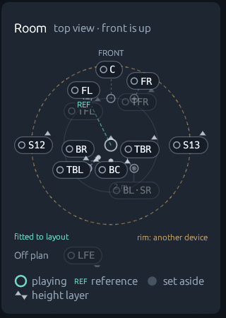
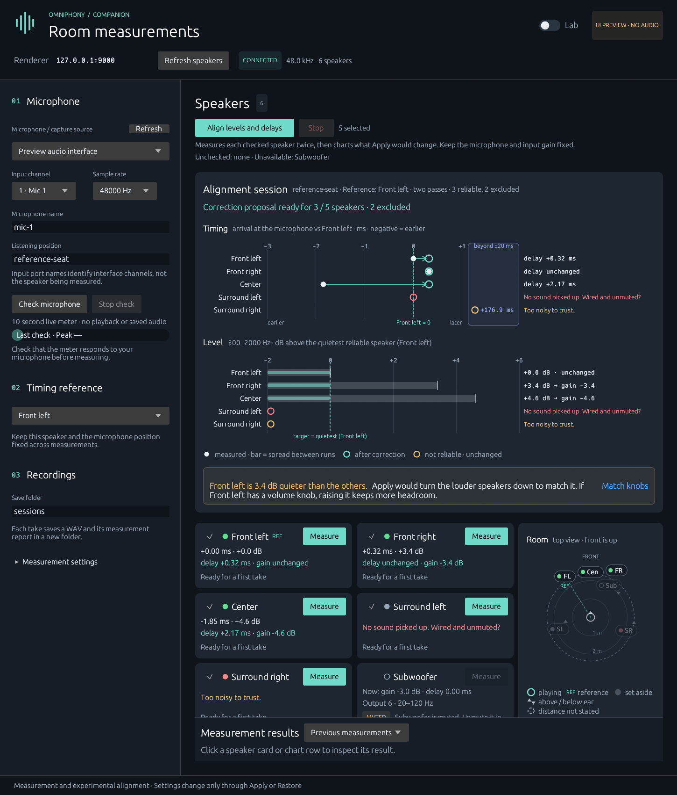
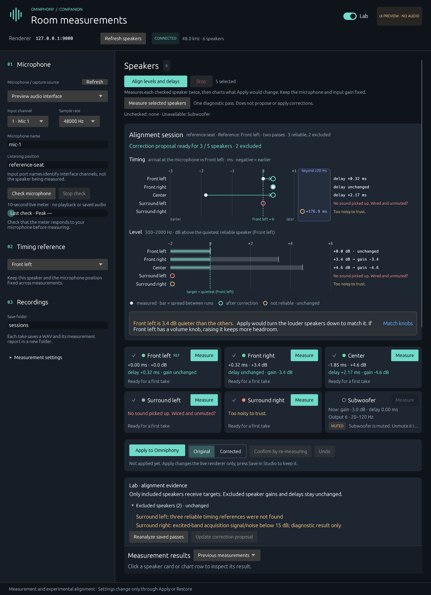
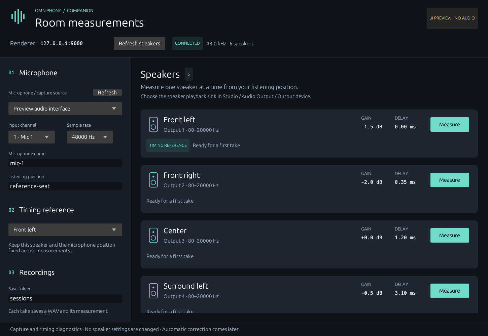
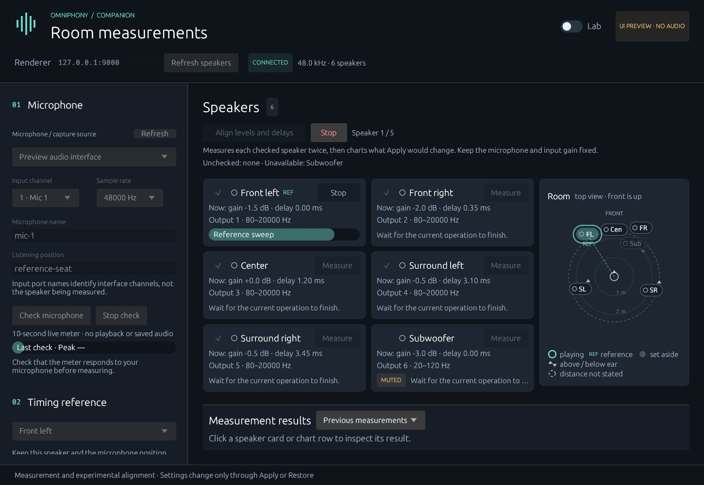
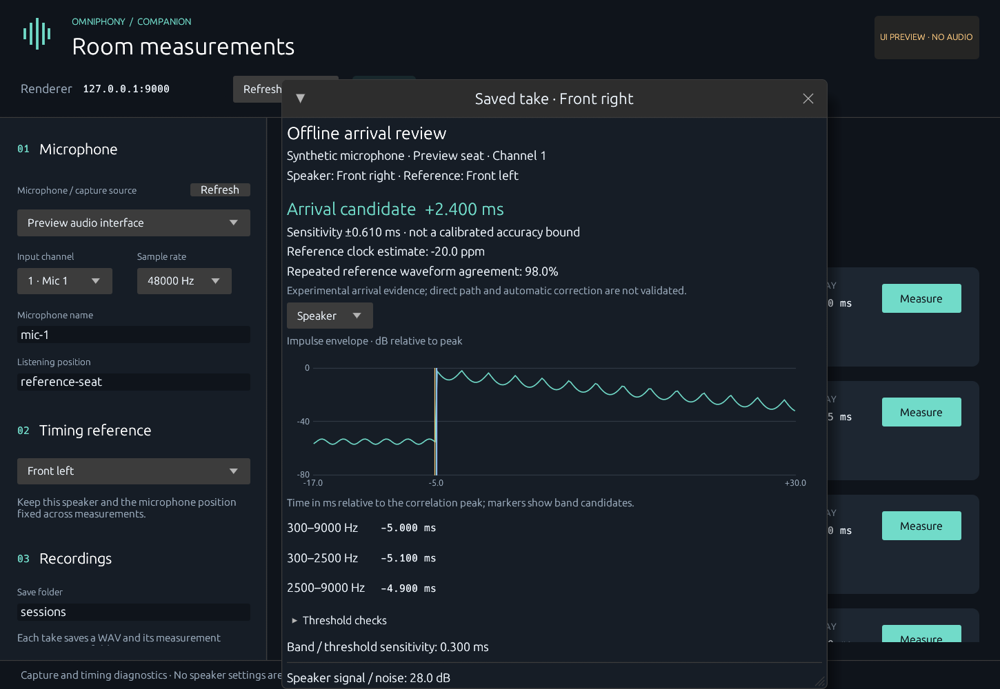

# Omniphony Companion

Acoustic calibration companion for [Omniphony](https://github.com/mgth/Omniphony).

**Status: native desktop UI, microphone capture, experimental repeated gain/delay alignment, and offline response review.**
The companion discovers renderer outputs, plays finite measurement sequences,
records a selected interface input channel and saves raw audio with quality reports.
The offline core can propose gains/delays from already-estimated observations.
Experimental arrival candidates can now be reviewed against impulse responses.
A separate two-pass workflow qualifies repeated arrival/level estimates, proposes
absolute gain/delay settings, applies them explicitly, and verifies them through
new captures. Hardware accuracy and direct-path identification remain experimental.
The CLI demonstration is explicitly simulated.

The [development plan](PLAN.md) describes the first mission's seven milestones
and later extensions: bass, subwoofers, reflections and overall refinement.

## Native companion UI

```sh
cargo run --locked -p companion-ui
```

The Rust/egui desktop window lets you:

- Refresh the available microphone inputs and choose an interface, input channel
  and sample rate. Selecting an input does not start recording.
- Use **Check microphone** for a ten-second live peak/RMS meter without playback
  or saved audio. Speak near the microphone to confirm the selected channel reacts.
- Connect to the local Omniphony address and list its physical speaker outputs,
  including current gain, delay, mute and frequency limits.
- Choose a fixed timing-reference speaker and a listening position.
- Match active speakers' physical volume: each speaker card's **▶ Noise** button
  plays finite pink noise on it, and the **Speaker levels** band below the cards
  shows a live microphone meter and the signed difference from the reference
  speaker, with the test level and reference controls under it. The noise skips
  each speaker's gain in Omniphony by default; a switch plays it through that
  correction to check the corrected result. Digital gains remain unchanged. The band also opens from the **Match knobs** hint (shown when
  the quietest reliable speaker trails the others by more than 3 dB).
  See `docs/manual-speaker-levels.md`.
- Start a measurement for one speaker, with progress inside its card and no layout shift.
- Check the wired speakers and use **Align levels and delays**, the main action, for
  two passes leading to a proposal. In Lab, **Measure selected speakers** runs one
  continuous diagnostic capture with shared reference sweeps. **Stop** cancels the complete run.
- Measure for room correction by default: each speaker swept over its own range up
  to 20 kHz for 3 s, a subwoofer over its bass range (kept out of timing and level),
  the alignment's level set from a quiet probe so the microphone peaks near −6 dBFS,
  and every take's unweighted response stored with a calibrated magnitude when a
  microphone calibration file is chosen. After an alignment, the setup rail guides
  five more microphone positions around the main seat, stored for room correction
  only. See `docs/room-correction-measurement.md`.
- Design one minimum-phase correction filter per speaker from those responses
  (**Correction filters** in the setup rail, or `correction-filters` on the command
  line): a gently tilted target up to 10 kHz, boosts of at most 3.5 dB and none below
  the speaker's own roll-off, the 500 Hz–2 kHz level kept. They are exported as WAV
  files for Studio's speaker editor, with the predicted response, how the positions
  agree and the strong early reflections. Not yet sent to Omniphony nor verified by a
  new measurement. See `docs/room-correction-design.md`.
- Restore input/channel/rate, renderer address, reference, microphone/position,
  sweep settings, recording/calibration paths and speaker checkboxes on startup.
- On a first run, the setup rail is already filled in: the first microphone input
  with a usable configuration at its preferred rate (48 kHz when supported), the
  centre speaker (else the front left) as timing reference, and the names `mic-1`
  and `main-seat`. Each value is shown as chosen, with a **change** link. A saved
  choice is never replaced, even if that device is missing.
- See how long a run takes before starting it ("5 selected · about 2 min" next to
  **Align levels and delays**; Lab's diagnostic pass and each card's Measure tooltip
  show theirs), and the time left while it runs, in the run label and the active
  card. Estimates come from the sweep, speaker count and passes; analysis time is
  machine dependent.
- Resume the previous workspace: recent measurements, saved review, alignment,
  selected result/graph, burst options, window size and panel layout. Saved results
  remain viewable while the renderer is offline. See `docs/workspace-restoration.md`.
- Review reference/target levels, clipping, missing sweep diagnostics and arrival evidence.
- Reanalyze completed rejected takes without playing audio; the original verdict is retained.
- Reanalyze saved recordings without playback; view impulse envelopes and
  frequency-band arrival candidates even while disconnected from Omniphony.
- Inspect frequency response, peak-energy arrival versus frequency and group
  delay in the result graphs. Reanalyze an old accepted take to add these views.
- Inspect signed impulse waveforms and predicted six-cycle tone bursts at
  selectable frequencies, including source overlays and relative phase.
- Inspect the selected speaker in a resizable, scrollable panel below the speaker
  area: impulse, frequency response, arrival/frequency, group delay, signed waveform
  and virtual burst views.
- Click a speaker card (or its row in the alignment chart) to open the latest saved
  analysis for that exact speaker/take. The selected card is highlighted; inclusion
  checkboxes and Measure/Stop act independently.
  This includes analyses created by **Reanalyze saved passes**. One speaker/result is
  selected at a time. **Original capture details** retains the historical verdict;
  it is separate from the current analysis status. Alignment summarizes both passes,
  while each measurement result identifies its individual pass.
- Read an alignment at a glance in the **alignment chart**: a Timing lane (arrival in
  ms relative to the reference speaker, a dot per repeatable speaker with a bar for the
  spread between runs, a hollow target circle and an arrow labelled with the delay
  Apply adds) and a Level lane (500–2000 Hz level relative to the quietest reliable
  speaker, with the corrected level overlaid and the gain Apply sets). Speakers that
  could not be measured reliably get a red or amber hollow marker and a short reason,
  such as "No sound picked up. Wired and unmuted?"; the technical reason stays in the
  tooltip. Reasons are typed codes from the service, never guessed from text.
  Arrivals more than 20 ms from the reference are drawn in a separate bracket
  with their offset.
- Repeatable speakers more than 20 ms from the others' median arrival (for example a
  second output device at +177 ms) are **set aside** by default: they keep their
  settings, are drawn in blue ("Set aside: 177 ms later than the others.") and the
  others are aligned without them. **Align to … anyway** below the chart includes one
  (every other speaker is then delayed to match it), **Set … aside again** undoes it;
  the choice is saved in the session. See `docs/gain-delay-alignment.md`.
- Above the chart, compact speaker cards show one quality dot (the weakest grade),
  the measured ms/dB and the planned delay/gain, or the one-line reason when a
  speaker is excluded. Cards keep a fixed size and place; capture progress stays
  inside the active card.
- Measure one speaker again into the alignment: when a session includes the
  speaker, a card's **Measure** opens a choice between **Measure again into the
  session** (two takes of that speaker, one per pass, in the same reference sequence
  and settings; they replace its takes, the proposal is rebuilt and the session folder
  updated, the other speakers keep theirs) and **One diagnostic take** (the plain
  take, as before). The session choice is greyed, with the reason in its tooltip,
  while the session is applied (undo it first), was measured on another renderer or
  with other settings, or the renderer's settings moved since. **Stop** keeps the
  previous takes.
- See where each speaker is on the **room map**, a top view beside the cards (below
  them in a narrow window): the listener in the centre, front up, each
  speaker as a chip at its layout azimuth, with the card's quality dot. A small mark
  shows each speaker's true spot (a dot at ear level, a triangle on the height
  layer); a chip moved off it to stay readable keeps a leader line to it, ear-level
  chips keep their spot first, and speakers sharing one layout position share one
  chip ("BL·SR"). Distances are seen from above (projected on the floor), so a height
  speaker stands over its bed speaker instead of being pushed outward; speakers
  straight above or below the listener (LFE) wait in an "Off plan" strip. Until an
  alignment has run, distances are Omniphony's layout geometry (measurement protocol
  5), normalised and unlabelled. Afterwards each repeatable speaker is drawn at its
  **measured acoustic distance**: its arrival minus its own output delay, at 343 m/s,
  relative to the timing reference, so it includes each output's electronic latency.
  The distances are fitted to the layout's by least squares, or anchored on a
  reference distance entered from the map's corner (a display preference, kept at
  once and never sent to Omniphony); rings are then labelled in metres, and a hollow
  ring marks the layout's distance when it differs by more than 0.3 m. A speaker far
  from the others in time (another output device) sits on the rim, distance unknown.
  The speaker being measured pulses; unchecked, muted, out-of-band, set-aside (late)
  and excluded speakers are dimmed; and the timing reference is labelled REF.
  Clicking a chip selects that speaker like its card (a shared chip selects its
  speakers in turn). A speaker whose distance the layout does not state sits on a
  dashed ring at the typical distance; an older renderer without positions shows no
  map.
- Use one action bar: **Apply to Omniphony**, an **Original / Corrected** switch for
  listening (restore or apply, available only with a proposal and an unchanged
  renderer revision), **Confirm by re-measuring** and **Undo**. One status line says
  whether anything is applied, that it is live only, and that Studio's Save keeps it.
- Turn on **Lab** in the header to see everything else: per-speaker raw arrival,
  level, repeat spread, quality and before → target settings; raw exclusion reasons;
  session pass details; **Reanalyze saved passes** and **Update correction proposal**;
  separate Acquisition/Timing/Level quality badges; segment signal/noise tables;
  band candidates and threshold checks; saved-take review; recent takes and the
  full caveats. The switch is saved with the other display preferences.
- Read quality at a glance: green check (Good), amber warning triangle (Limited),
  red cross (Poor), grey dash (Unavailable/Not rated). Labels and tooltips explain
  each grade; the symbols use vector drawing rather than emoji fonts. Without Lab,
  a result shows one badge with its weakest grade.
- Measure alignment in two passes, inspect gain/delay proposals, explicitly apply,
  verify with two further passes, and restore the original settings.
- Reopen a saved alignment folder without automatically measuring or applying it.

**Captured · arrival candidate** means the new impulse analysis found a repeatable
early peak. **Captured · arrival unresolved** means the impulse responses are
available but the timing evidence disagrees. Both are acquisition successes;
neither alone authorizes correction. The separate alignment workflow additionally
requires independent target repeats and comparable levels. The older correlation diagnostics remain in the saved report and may still
show **Unresolved**. Increasing volume does not resolve
arrival ambiguity.

There is no manual approval step for an unresolved arrival. Expand **Arrival
diagnostics** below the graphs to inspect the reasons. The new **Signed waveform**
and **Virtual burst** tabs provide experimental inspection views. Virtual bursts
are derived from the measured impulse response; no new burst is played. See
[signed waveforms and virtual bursts](docs/virtual-bursts.md).

The **Arrival / frequency** view helps inspect timing differences across a
speaker's frequency range. **Group delay** also includes crossover phase and room
effects. Both use one correlation-peak zero, and neither identifies individual
drivers or proves a direct arrival. The spectral response includes the room and
microphone and covers only the sweep's excited range. See
[frequency-dependent timing](docs/spectral-timing.md) for interpretation and limits.

The **Measure** button becomes available when the renderer, microphone, channel,
reference and sweep settings are usable. Each take plays a sweep on the reference,
the selected speaker, then the reference again. It uses the same acquisition
service as the CLI. A fresh renderer snapshot is checked before opening the input.
Ordinary Measure actions apply no corrections. Alignment has separate explicit
Apply/Restore actions; neither writes the persistent renderer configuration.

**Align levels and delays** runs two independent passes leading to a proposal.
**Measure selected speakers** (Lab) runs one diagnostic pass instead; you do not
need to run both. The speaker area summarizes unchecked and currently
unavailable outputs. Alignment results retain each pass's completion/failure and
show when the next pass never started; older sessions without this history are
labeled explicitly.

Each acquisition rechecks the current input during its quiet lead-in, before
starting a sweep. Exact digital silence, clipping, capture faults or insufficient
fresh frames stop playback with a specific reason and retain the partial recording.
Quiet nonzero background noise is allowed: input activity does not establish
correct microphone identity or acoustic quality. Digital sink-monitor diagnostics
allow pre-playback silence because that source is expected to be silent before a
sweep; sink monitors still cannot produce alignment proposals. See
[microphone checks](docs/microphone-check.md).

Whole-system capture plays **reference → speaker 1 → reference → speaker 2 →
reference → …**. The reference between two speakers is recorded once and reused
in both results. Each speaker still has independent acquisition diagnostics.
Uncheck unwired speakers before starting; muted outputs and outputs incompatible
with the chosen sweep are excluded. See [batch capture](docs/batch-capture.md)
for recording limits, cancellation and saved-take review.

Connect to a build from the [Omniphony calibration PR](https://github.com/mgth/Omniphony/pull/864), normally
`127.0.0.1:9000`; use the OSC port configured for your dedicated calibration workflow.
The UI does not launch Omniphony itself. Change the address and press **Connect**
or **Refresh speakers** after changing its speaker layout or settings.

Discovery and measurement run in background service workers. Minimizing the
window does not pause keepalives or capture. Closing it during measurement requests
cancellation and waits for cleanup so the rejected partial take can be saved.
Results are kept in the window for the current run; raw WAVs and JSON reports
remain in the recording folders. In Lab, use **Review a saved take · no playback**,
paste a take folder, and press **Analyze saved take** to reopen a recording.
A current result also has a **Reanalyze this take** action. This reads the take
and generates a fresh report; it does not restore acquisition settings.

To inspect the layout without an interface or renderer:

```sh
cargo run --locked -p companion-ui --example preview
cargo run --locked -p companion-ui --example preview -- --arrival-review
cargo run --locked -p companion-ui --example preview -- --missing-target-review
cargo run --locked -p companion-ui --example preview -- --batch-progress
cargo run --locked -p companion-ui --example preview -- --alignment
cargo run --locked -p companion-ui --example preview -- --alignment --lab
cargo run --locked -p companion-ui --example preview -- --blocked-alignment
cargo run --locked -p companion-ui --example preview -- --late-device
cargo run --locked -p companion-ui --example preview -- --frequency-response
cargo run --locked -p companion-ui --example preview -- --energy-arrival
cargo run --locked -p companion-ui --example preview -- --group-delay
cargo run --locked -p companion-ui --example preview -- --signed-waveform
cargo run --locked -p companion-ui --example preview -- --tone-burst
```

This fixture window is labelled **UI PREVIEW · NO AUDIO**. Its speakers and
microphone are synthetic; clicking Measure does not open hardware or create
recordings. `--alignment` shows the chart with an invented five-speaker alignment
(three repeatable speakers, one silent, one noisy at a long delay); `--late-device`
shows a repeatable speaker 60 ms late, set aside, with its include link; `--lab` starts
with Lab on. The synthetic room places its 5.1 speakers on the map, with surrounds
above the ear and a floor subwoofer whose distance is not stated. `--bench` replaces
it with a crowded 14-output bench taken from one real session: stacked heights, two
outputs sharing a position, an LFE straight below and two height speakers on another
device, measured after a first alignment:





With **Lab** on, the same window adds the raw per-speaker evidence, exclusion
reasons, pass details and the Reanalyze/Update actions below the action bar:





During capture (`--batch-progress`), the speaker playing pulses on the room map:



The native frontend uses egui/eframe 0.32 with OpenGL to retain the workspace's
Rust 1.89 minimum. This increment is validated on Linux; native packaging and
hardware validation on Windows/macOS remain pending.

Settings save automatically after edits and when the window closes. On Linux the
file is `$XDG_CONFIG_HOME/omniphony-companion/settings.json`, or
`~/.config/omniphony-companion/settings.json` when XDG_CONFIG_HOME is unset.
Windows uses `%APPDATA%/omniphony-companion/settings.json`; macOS uses
`~/Library/Application Support/omniphony-companion/settings.json`.
The previous measurement results, alignment, selected graph and window layout
also return on startup. The first upgrade imports up to 100 recent takes from
the recording folder. Recordings and analysis results remain in their session
folders; their saved references use absolute paths. Relative acquisition paths
still resolve from the application's working directory. See
[workspace restoration](docs/workspace-restoration.md) for details and limits.

Startup enumerates inputs and reconnects to the saved local renderer address.
It does not start capture or playback. Missing devices, unsupported channels and
missing/muted references retain their selections and prevent measurement until
resolved; no replacement input or reference is silently selected. Reconnect the
device and press **Refresh**, or choose another input explicitly. A corrupt or
unsupported settings file is kept untouched with a visible load error; write
failures show an error and a **Retry saving settings** action. Preview fixtures
never read or write personal settings. See [the application boundaries](docs/ui-architecture.md).

## Experimental delay and level alignment

1. Select the working broadband speakers, one microphone input and a fixed timing
   reference. Keep the microphone at the listening position and the preamp gain fixed.
2. Pick **From zero** or **Refine** beside **Align levels and delays**, then choose
   it. **From zero** sets the measured speakers and the reference to 0 dB and 0 ms
   for the passes and puts their settings back afterwards: the proposal is absolute,
   the quietest speaker at 0 dB and the latest at 0 ms, whatever the outputs had.
   Speakers whose gain is lowered now play louder while measured. **Refine** measures
   through the current gains and delays and corrects on top of them. Refine is the
   default while an alignment is applied, and a new alignment may then start on top
   of it; From zero is the default otherwise. A choice holds for one alignment.
   From zero cannot be applied while a speaker it zeroed is left out of the
   correction with other settings than 0 dB and 0 ms from before: applied, the others
   would move to absolute settings and it would not. Measure it again into the
   session, align a set-aside speaker anyway, or leave it out of a new alignment.
   Each pass uses the shared-reference sequence. Progress remains in the active speaker card, and the speaker playing
   pulses on the room map; Stop cancels the run. The previous chart's space stays
   reserved during capture, so the chart, the map and the cards do not move.
3. Read the result in the alignment chart and the speaker cards; Lab shows the raw
   per-speaker numbers. Levels use equal log-frequency
   power weighting over 500–2000 Hz, including the room response. They are transfer
   dB, not sweep RMS, calibrated SPL or microphone-corrected levels.
4. Each included speaker must pass acquisition/arrival checks,
   15 dB excited-band acquisition SNR, 20 dB integrated estimated SNR over the
   complete level band, at most 0.15 ms arrival variation and
   0.50 dB level variation between independent target captures, and stable reference
   levels. These are prototype gates, not certified accuracy. Ambiguous speakers
   remain visible with an exclusion reason. A proposal uses the qualified subset
   when at least two speakers qualify; excluded gains and delays stay unchanged.
   Use **Update correction proposal** (Lab) for complete original saved passes created
   by an older build. Shared-reference or session failures still block application.
5. **Apply to Omniphony** changes live absolute settings. The policy attenuates
   louder speakers and delays earlier arrivals, from zero or on top of the existing
   gains and delays (step 2). Application requires the unchanged renderer snapshot. The
   **Original / Corrected** switch restores or re-applies the same settings for listening.
6. **Confirm by re-measuring** measures the corrected subset again, twice, and reports before/after arrival and level
   spread. A failed or unresolved verification is not success. **Undo** (or
   **Original**) restores the settings from before the alignment, not zero, only if
   the renderer has not changed meanwhile.
7. Save in Studio after a satisfactory result if you want persistent renderer
   settings. Companion never sends the configuration-save command automatically.

The session folder retains `alignment-plan.json`, `alignment-state.json`, both raw
capture passes and verification captures. Use **Load alignment session** in the
Lab saved-take section to reopen it. Loading never emits audio or writes renderer
settings. A session is tied to the speakers and their settings, not to the port:
after a new port or a restart, a renderer with the original settings shows the
session as not applied, and one with the corrected settings as applied, ready to
undo. A renderer whose settings differ from both cannot apply or undo it, and a new
alignment can start. An uncertain application must be inspected before further
changes.

No subwoofer alignment, EQ or independent-driver correction is enabled. A repeatable
reflection can still resemble a direct arrival; the user must keep an unobstructed
measurement geometry. See [the method and validation](docs/gain-delay-alignment.md).

## Try it

Requires Rust 1.89 or later. On Linux, install ALSA and PipeWire development
headers, Clang and pkg-config:
`sudo apt-get install libasound2-dev libpipewire-0.3-dev libclang-dev pkg-config`. The offline
demonstration needs no audio device or Omniphony service.

```sh
cargo run --locked -p companion-cli -- demo --out-dir sessions/demo
cargo run --locked -p companion-cli -- inspect --session sessions/demo/session.json
cargo run --locked -p companion-cli -- plan --session sessions/demo/session.json --out sessions/proposed.json
cargo run --locked -p companion-cli -- verify --session sessions/demo/session.json --profile sessions/proposed.json --measurements sessions/demo/verification-measurements.json --out sessions/checked.json
```

The demonstration represents three speakers, a subwoofer preserved without
automatic correction, two microphones and two positions. The initial policy
aligns speakers only at the reference position. A second set of observations
is generated from the modified rig state, then verified. The rig is subsequently
restored to its initial settings.

At the reference position, the scenario reduces arrival spread from 2 ms to
0 ms and level spread from 5 dB to 0 dB. These are deterministic simulator
results, not measured accuracy in a real acoustic environment.

The command produces:

- `session.json`: installation, microphones, positions and initial observations;
- `profile.json`: policy, initial state and proposed absolute settings;
- `verification-measurements.json`: a new set of observations;
- `verification-report.json`: before/after deviations and verification status.

Existing output paths are refused. Choose a new directory to run the demonstration
again. Local sessions are ignored by Git.

## Renderer measurement control

Requires an Omniphony build with OSC contract revision 9 and measurement protocol
version 4 or 5 from the calibration development branch. The Companion speaks
version 5, whose discovery adds each output's layout position for the room map;
when an older renderer refuses it, discovery continues in version 4 without
positions. Saved version-2 and version-3 takes remain reviewable.
The adapter uses its existing local TCP listener, normally port 9000.
It shares the typed protocol through a pinned revision of Omniphony's
`omniphony-osc-contract` crate; no local sibling checkout is needed to build.

```sh
cargo run --locked -p companion-cli -- renderer discover --out renderer-snapshot.json
cargo run --locked -p companion-cli -- renderer sweep --snapshot renderer-snapshot.json --output L --duration-ms 1000 --peak-dbfs -30 --start-hz 200 --end-hz 10000 --out-dir sessions/first-sweep
```

Use an output ID returned by discovery; `L` is an example. Pass `--endpoint
127.0.0.1:9003` to either command when using a renderer on another port.
The sweep command **plays sound**. It creates a new directory containing the
initial snapshot, stimulus request and completed render report. It records no
microphone data and makes no acoustic accuracy claim. Existing directories are
refused before playback. Add `--reference-output L` to exercise the three-segment
sequence without microphone capture.

The renderer owns stop deadlines, enforces one session owner, rejects stale
configurations and blocks other control writes until the session ends. During
the session it silences programme audio and emits the sweep only on the selected
output, through existing output gain and delay. The sweep bypasses spatial
panning/crossovers, stays within the output's declared frequency band and has
250 ms settling silence before and after. No settings are saved or changed.

The CLI polls every 200 ms to renew the three-second lease. Ctrl+C disconnects
it; the renderer stops the abandoned session. The Rust adapter also exposes
explicit `stop` and `end` operations. A host that does not render expires the
signal instead of reporting completion. Render progress is not a DAC timestamp
or an acoustic timing reference.

See the [wire protocol](https://github.com/mgth/Omniphony/blob/41a4afc485da23c255d59057eb526a7122a71fb6/docs/measurement-protocol.md)
for limits, identifiers and the hardware-free `measurement_fixture` bench.

## Single-microphone acquisition

The first workflow targets an audio interface with one measurement microphone.
Linux uses native PipeWire when its server is available. Sources have their
actual descriptions and port names, such as a USB microphone and `capture_FL`.
The channel count comes from the node's audio ports; MIDI ports are excluded.
The complete input channel map is requested without remixing, then only the
selected channel is retained. The target is pinned for the take; removal rejects
the capture instead of switching to a default microphone.

Sink monitors are also selectable and explicitly labelled. They record a digital
output for routing diagnostics, not an acoustic room response. Saved reports mark
these takes as `sink_monitor_capture`. To choose where the test speakers play,
use **Studio → Audio Output → Output device**; Companion's selector controls
what it records. Neither choice changes the system-wide default device.

Without PipeWire, Linux falls back to CPAL/ALSA. macOS uses CoreAudio and Windows
uses WASAPI. ASIO and an electrical loopback channel are not implemented yet.
The CLI takes the exact `name` field from `capture devices` (for example
`pipewire:source:your-node-name`) and a one-based input channel:

```sh
cargo run --locked -p companion-cli -- capture devices
cargo run --locked -p companion-cli -- capture measure --snapshot renderer-snapshot.json --device "Your interface" --input-channel 1 --sample-rate 48000 --microphone-id mic-1 --position-id reference-seat --output R --reference-output L --out-dir sessions/first-capture
```

Device enumeration does not record audio. `capture measure` records the selected
channel and plays a reference–target–reference sequence. Use actual output IDs
from discovery. Set the interface's gain manually and keep it, microphone
position, routing and processing fixed across compared takes. Disable microphone
AGC/noise suppression. Absolute SPL calibration is not provided.

The renderer schedules identical swept-sine segments at known sample offsets.
The companion estimates the capture/render clock ratio from the two reference
peaks, then uses their midpoint to estimate the target's relative peak delay.
No network timestamp is used as an audio time reference. The same reference
speaker must be used throughout a comparison. Input and output may have
different nominal rates; the sweep must fit both Nyquist limits.

Each new take directory contains:

- `recording.wav`: the selected channel, float32 PCM, including lead-in and tail;
- `snapshot.json` and `stimulus.json`: settings, identities and exact stimulus;
- `capture-report.json`: input configuration, quality flags, raw level checks,
  timing diagnostics/warning or rejection reason, impulse analysis when available,
  and the frame origin for analysis;
- `response.wav` and `response.json`: the take's unweighted impulse response, kept
  for room correction (see [room-correction measurements](docs/room-correction-measurement.md));
- `microphone-calibration.txt`, if supplied with `--calibration` or chosen in the UI:
  preserved frequency/relative-dB data. Only the magnitude stored in
  `response.json` is corrected with it; the recording, the stored response, timing
  and levels stay uncalibrated.

PipeWire may resample to the chosen recording rate. Its metadata records that
continuity checking uses chunk flags and callback cadence, not device timestamps;
small discontinuities and all upstream clock behavior are not established by
this check. Hardware validation remains necessary.

Stream errors, queue overflow, detected timing gaps, clipping and missing or
ambiguous sweep sequences remain capture faults. Completed low-SNR or unstable
reference-level captures now retain results with quality warnings. Even clipped
takes may have diagnostic response curves, without qualifying a correction.
A clipped take also reports how far the sweep overshot full scale, from a fit of
the known sweep frequency to the unclipped samples before each plateau, and the
hint suggests lowering the gain by that much plus 3 dB; analog preamplifier
saturation below full scale is not detected. During an alignment such a speaker is
measured again by default with its output gain lowered by that amount, restored
afterwards, and its level counts the change back (see
[gain and delay alignment](docs/gain-delay-alignment.md)).
Excited-band SNR grades are Good (at least 20 dB), Limited (15–20 dB), or Poor
(below 15 dB); missing evidence is Unavailable. Timing still needs a synchronized
sequence within 2000 ppm linear drift. These are prototype indicators, not
hardware accuracy guarantees. See [measurement quality](docs/measurement-quality.md).
Competing arrival peaks within an otherwise valid sweep sequence produce a
timing warning. Acquisition and level diagnostics remain available, while delay
and clock drift are withheld. Capture-report schema version 3 records
`timing.ambiguous_peaks`, the competing-peak ratios and background RMS; its
`relative_peak_delay_ms` and `clock_drift_ppm` fields are nullable.
`accepted_for_analysis` confirms acquisition checks, not validated arrival timing.
Ctrl+C ends the session and saves the partial take as rejected. Connection
failure follows the same cleanup path. Force-killing the process or a disk
failure can prevent saving; the renderer still has its own stop limits.

**Timing reports are diagnostics, not calibration observations.** A dominant
reflection can obscure the direct sound. Two references estimate linear drift
but cannot establish clock stability throughout the take. No capture is marked
valid for correction on its own. The separate two-pass alignment workflow qualifies
new repeated measurements before offering a proposal.

Callbacks only convert the selected channel into a bounded queue. File writes
and FFT correlation happen off the audio thread. Captures are capped at 30 s;
the queue holds four seconds of mono samples and reports overflow instead of
hiding lost data. Offline analysis has a bounded FFT size and can use substantial
memory at high sample rates; 48 kHz is the initial bench target.

Deterministic tests cover unequal sample rates, known delays, positive/negative
clock drift, inverted polarity, noise, missing references, clipping and strong
competing reflections. Real interface/microphone repeatability remains to be
measured. See [the capture validation checklist](docs/capture-validation.md).

## Offline measurement review

```sh
cargo run --locked -p companion-cli -- capture review --take sessions/first-capture
```

The UI's saved-take review uses the same service. No microphone, audio output or
renderer connection is opened. A new `analysis-*.json` is saved beside the source
files; `recording.wav`, `stimulus.json`, `snapshot.json` and the original capture
report are never overwritten. The command returns success when review completes,
even if arrival timing remains unresolved; malformed or faulty acquisitions return
an error. Completed takes rejected for clipping or missing sweeps can now be
inspected with quality indicators. Available results are retained for completed
low-SNR, clipped and legacy ambiguity cases; a missing target does not receive an
invented delay. Original rejection reasons remain visible. Interrupted, faulty or
mismatched takes cannot be promoted by reanalysis.

For a saved two-pass alignment, choose **Reanalyze saved passes** in the Lab
alignment evidence below the speaker cards, or run:

```sh
cargo run --locked -p companion-cli -- capture review-alignment --session sessions/example-alignment
```

This writes a separate `alignment-review-*` report with updated estimates and
quality grades. It never opens an audio device or contacts the renderer, and
cannot apply a profile. Start a fresh alignment for application and verification.

The analyzer reconstructs the emitted sweep, compensates its candidate constant
clock ratio and performs regularized, band-limited deconvolution. It retains three
impulse responses (reference, speaker, reference). The UI shows a peak-preserving
envelope and arrival markers for the broad, lower and upper analysis bands.
The report also retains the full band-limited response samples and their time axis.

An early local peak is tested across three frequency bands and detection
thresholds. Timing is withheld when those choices disagree or the repeated
reference waveforms do not match. A reported sensitivity bound describes those
choices; it is **not a calibrated accuracy or statistical confidence interval**.
An undetectable or obstructed direct sound can still leave a repeatable reflection:
no candidate is a validated direct-path observation. Individual reports retain `valid_for_correction: false`. A separate alignment
session evaluates two independent target captures and their level evidence before
offering an experimental proposal; existing single takes are not promoted.

This increment targets broadband speakers, not subwoofer alignment. Microphone
calibration, nonlinear clock validation and hardware accuracy assessment remain
pending. The alignment workflow adds a fixed-band relative level estimator. See [the analysis method and
validation](docs/arrival-review.md) for the versioned algorithm, gates and limits.

See [acquisition diagnostics](docs/acquisition-diagnostics.md) for reference-pair
windows, per-interval levels and their limits. Raw sweep RMS is not a calibration
gain estimate.



## Offline calibration capabilities

- Versioned JSON model with output, microphone and position identifiers.
- Validation of values, references, duplicates and reference-position coverage.
- Rejection of clipped, unsynchronized or insufficient-SNR measurements.
- Conservative proposals: delay early arrivals and attenuate louder speakers,
  accounting for already-active gains/delays.
- Separate verification using observations after application.
- Idempotent application/restoration preparation that rejects stale state or
  edits made since measurement.
- Document persistence without overwriting existing files.

Imported observations must already be comparable: the same stimulus/emission
level, level measurement method, microphone calibration and timing reference.
Declarative fields alone do not establish this quality. Capture diagnostics are stored separately and do not yet produce
these observations on their own. The repeated alignment workflow derives a
separate session with origin `measured` and records its qualification evidence.

The initial policy requires the same microphone for observations at the reference
position. Other positions and microphones are retained for later stages; they
are not averaged and do not contribute to the current verdict.

`verify` returns 0 when tolerances are met, 2 when valid measurements fail the
tolerances, and 1 when data or files are invalid. Default tolerances (0.1 ms /
0.5 dB) are prototype thresholds requiring hardware validation. The report
does not assess the entire listening area.

## Architecture and limitations

- `crates/calibration-core`: models, validation, proposals and verification;
  no audio hardware, network, file access, timers or UI toolkit.
- `crates/companion-cli`: command parsing and the simulated rig.
- `crates/companion-service`: discovery, readiness checks, background jobs,
  cancellation, acquisition orchestration and persistence shared by CLI/UI.
- `crates/companion-ui`: native egui views; no audio callback or protocol implementation.
- `crates/measurement-capture`: bounded input capture, calibration-file parsing
  and offline timing/impulse-response diagnostics; no correction policy.
- `crates/omniphony-adapter`: typed TCP requests, acknowledgements, session
  ownership and protocol validation; independent of the calibration core and UI.

The core accepts qualified arrival/level observations. Single-capture diagnostics
remain separate; repeated alignment records experimental measured observations.
The live adapter applies absolute targets using a renderer revision check and
one live-state publication, then checks the returned settings. Restoration refuses
intervening changes. Missing acknowledgements leave application uncertain.
The adapter's snapshots and render reports are separate from acoustic observation
sessions; renderer instance IDs are not permanent installation IDs.

The next checks are real-interface repeatability and before/after acoustic
validation. Guided multipoint acquisition, automatic optimization iterations and
advanced corrections remain deferred until delay/level alignment is qualified.

## Development checks

```sh
cargo fmt --all -- --check
cargo clippy --workspace --all-targets --locked -- -D warnings
cargo test --workspace --locked
cargo +1.89.0 check --workspace --all-targets --locked
```

CI is configured to run these checks, the demonstration and a Rust 1.89 build.
Changes go through a dedicated branch and a PR for review.

All repository content and project communication must be in English. See
[the development agreement](AGENTS.md).

### Long-latency outputs

Stable device latency above 100 ms is accepted and shown as a **Long delay**
warning in arrival review and repeated alignment. A slow projector or other
processed output can participate: earlier outputs receive the required delay.
This adds audio latency and may require audio/video sync adjustment. Repeats,
SNR, clipping and reference-agreement gates still apply. Timing candidates must
remain distinguishable within their sequence slot; the warning does not certify
a direct acoustic path.

Live proposals use the renderer's advertised delay capacity. The companion
accepts version-4 renderers advertising up to 250 ms (the sweep settling time);
older 100 ms renderers remain usable but cannot apply a larger correction.
The dedicated renderer change increases the actual delay rings to 250 ms.
Measurements are retained even when an older renderer cannot apply their proposal.
See `docs/long-latency-alignment.md` for bounds and validation.

## License

GPL-3.0-or-later. See [`LICENSE`](LICENSE).
