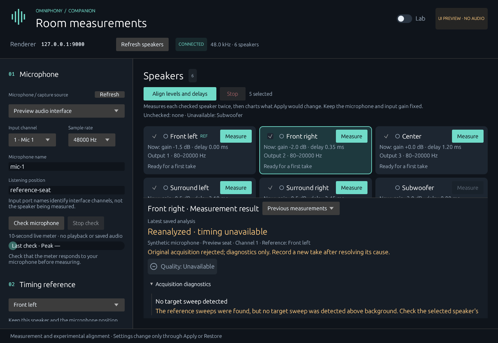

# Acquisition diagnostics

The UI and `capture review --take PATH` explain completed captures even when
clipping or a missing sweep prevented timing analysis. They preserve the original
recording and verdict. These diagnostics cannot establish a direct arrival,
identify the actual loudspeaker, or generate correction gains.

## Method: reference-pair-acquisition-v2

The offline analyzer correlates the recording against the exact finite sweep.
It looks for two reference candidates separated by two segments, independently
of target detection. A second pass compensates the template's clock ratio.
Candidates require normalized correlation of at least 0.2; another plausible
pair within 80% of the best pair's weakest score makes the sequence ambiguous.
The final reference spacing must remain within 2000 ppm of the nominal clock
ratio. Reference levels below 20 dB SNR remain visible as diagnostic evidence
but do not pass acquisition. Missing, ambiguous or truncated references leave
per-interval results absent;
it does not imply a silent target.

Reference correlation peaks anchor the three approximate sweep-body windows.
A detected target match anchors its body window; otherwise the midpoint predicts
the window so it can be inspected even when no target sweep is detected. Body RMS
uses one sweep duration;
peak and clipping counts include a 100 ms margin on each side. Values are
relative to `analysis_start_frame`, like the existing timing reports. Background RMS uses 100 ms of the first reference's pre-padding, ending 20 ms
before its sweep body, to avoid the preceding delayed target in a batch excerpt.
If reference localization fails, whole-take diagnostics retain the initial
100 ms background estimate. Values use a -200 dBFS
floor for finite serialization of silence. Total clipping counts cover the
analysis slice; original capture metadata retains whole-recording counts.

The interval classification, in priority order, is:

| Condition | Diagnostic |
| --- | --- |
| Any sample reaches absolute value 0.999 | Clipped |
| Body (signal + noise) / noise below 6 dB and correlation below 0.2 | No sweep detected |
| Body (signal + noise) / noise below 20 dB | Low signal / noise |
| Correlation below 0.2 despite sufficient energy | Signal without a reliable sweep match |
| Remaining cases | Sweep detected |

Target correlation is searched within ±45% of segment spacing; reference
neighborhoods remain ±100 ms. Long target latency is reported as an advisory,
including when weak reference SNR prevents qualification. The
thresholds are prototype diagnostics, not a proof of absent sound or a hardware
fault. Output routing, a mute, amplifier power, cabling, interference, an
unexpected delay or microphone selection can require further checking. Changed
reference levels and reference clipping are reported separately.

## Review and persistence

Capture-report schema 3 adds optional diagnostics. Saved review reads capture
schemas 1–3 and writes a new analysis-report schema 2 with the original acceptance
and rejection reason, diagnostics and optional timing/impulse results. Completed
rejected takes receive diagnostics only, except the existing explicitly
recognized schema-1 correlation-ambiguity case. No rejection is removed.
Interrupted, faulty, identity-mismatched, nonfinite or inconsistent recordings
remain refused. Diagnostic input is also bounded to absolute sample values of
16 to keep malformed float WAVs out of the FFT. Clipping counts are recomputed and checked against metadata.

Live acquisition uses the same diagnostic code after saving raw audio. It does
not relax acquisition gates. No audio callback or renderer behavior changes.

## Interpretation and next checks

If the references are clear and the target interval stays near background,
check the end-to-end route for that speaker before raising the global level.
If the target clips, reduce playback or input gain and repeat that speaker.
If the sweeps are detected but the arrival is ambiguous, inspect the impulse
response; higher volume does not resolve competing arrivals.

Whole-sweep RMS includes room response, frequency weighting from the stimulus,
and approximate window alignment. It is not a representative-band level estimate
and must not become an automatic gain adjustment. Microphone calibration,
validated level bands/windows and hardware repeatability remain future work.

Deterministic tests cover missing targets and references, unequal rates and
clock drift, clipping, weak sweeps, unrelated loud sound, ambiguous sequences and
invalid recordings. Service tests verify preserved files and rejected verdicts;
UI tests verify diagnostic review without device access. Real installation
routing and acoustic repeatability still need end-to-end verification.

