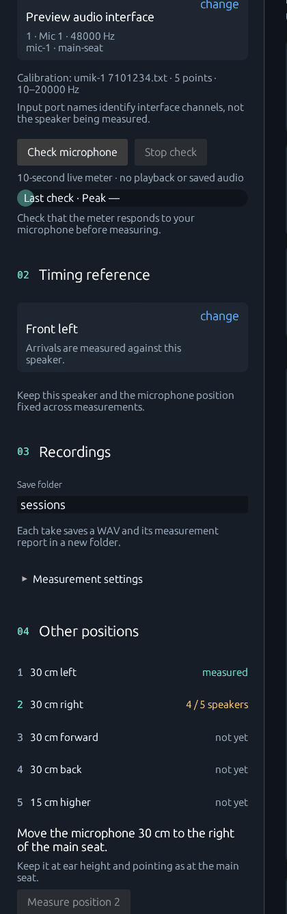

# Room-correction measurements

Measurements for the room-correction design step: full-range sweeps at a level
chosen from a probe, takes that keep the response a correction filter can be designed
from, and guided microphone positions around the main seat. Nothing here designs, sends or applies a
filter, and nothing changes timing, levels, alignment proposals or a take's verdict. The
filters are designed from these responses as described in
[room-correction filter design](room-correction-design.md).

## The stored response

The arrival review deconvolves each segment and then weights it into 300–9000 Hz
raised-cosine bands to find early peaks; the `impulse.segments[].response` of the
capture report is that band-weighted response, about −25 dB at 500 Hz against
+15 dB at 4 kHz relative to its shape before weighting. It stays as it is and keeps
serving the arrival review, but it cannot be equalized.

Every take with located sweeps now also stores:

- `response.wav`: three float32 channels, `reference_before`, `speaker`,
  `reference_after`, from 100 ms before each segment's correlation anchor to 350 ms
  after it. No band weighting and no microphone calibration. The extraction window
  ends 150 ms after the segment's trailing 250 ms of silence, so every swept
  frequency has its full tail up to 400 ms and the next sweep is never inside it.
- `response.json`: how to read it (compact, about 40 KB): the clock-compensated
  rate (`sample_rate_hz`; the WAV header can only hold the nominal capture rate),
  the anchor frame and each segment's sub-frame anchor offset, identities
  (output, reference, microphone, position), the sweep, the take's verdict and
  clipping count, the calibration used, and the magnitude.

The capture report references it as `response_file` (or gives `response_error`).
Clipped or rejected takes keep a response for inspection; `accepted_for_analysis`
and `clipped_samples` in `response.json` say not to design from them.

This response uses its own deconvolution. The arrival review resamples the sweep
template with linear interpolation, which droops the treble whenever the capture
and render clocks differ (up to about 2 dB at 10 kHz at 48 kHz, depending on the
sample phase). The stored response evaluates the sweep analytically at the
compensated rate instead, so its magnitude holds within 0.1 dB of a synthetic
room's from 300 Hz to 9 kHz at 120 ppm drift. It also accepts any valid sweep,
bass-only ones included, which the arrival review refuses.

### Magnitude

`magnitude` averages power over 1/48 octave at the grid frequencies
`1000 · 2^(k/48)` covering the sweep, so takes at any rate share frequencies. The
window opens 10 ms before the anchor (5 ms raised-cosine rise) and closes over the
last 50 ms of the stored response. `noise_db` is the deconvolution noise in the same
window, from the 80 ms before the anchor: `magnitude_db − noise_db` approximates the
signal-to-noise ratio per frequency. Fractional-octave smoothing, frequency-dependent
windowing and spatial averaging are left to the design step, which can recompute
them from `response.wav`.

## Sweeps

**Measurement settings → Sweeps → Room correction** is the default. Each speaker is
swept from its declared low limit (`freq_low_hz`, at least 20 Hz) to 20 kHz, its
declared high limit or 0.45 times the lower of the render and capture rates, for
3 s. The renderer refuses a sweep that starts below `freq_low_hz`, so the roll-off
below it cannot be measured until the protocol allows it (bass-managed sweep, phase
2). **Custom** keeps the duration and range typed below it, for every speaker.

The renderer plays one sweep for the reference and every target of a sequence, so
speakers are grouped by the sweep they share: one sequence per group in each pass,
in a `sweep-N` folder of the pass when there are several. The reference plays every
group's sweep, so a broadband speaker's range is narrowed to what the reference
plays (a full-range front left starts at 80 Hz behind an 80 Hz centre). The sweep is
shortened in 100 ms steps, down to 1 s, when a group's sequence would exceed the
renderer's 120 s or the recording budget (now 7 million frames, 146 s at 48 kHz):
3 s fits 16 speakers in one sequence.

A broadband sweep covers the arrival review (300–9000 Hz) and the 500–2000 Hz level
band exactly as the old 200 Hz–10 kHz sweep did; the arrival and level methods do
not change. Its acquisition signal/noise is graded over 200 Hz–10 kHz, only over the
part of the sweep that is in that band, so room rumble below 200 Hz and hiss above
10 kHz do not lower the grade and a 3 s full-range sweep grades like the 1 s
alignment sweep. Clipping estimates follow the sweep's instantaneous frequency and
need no change. The per-take window stays within the 30 s analysis bound (about
11 s for 3 s sweeps) and the deconvolution FFT within its bound at 192 kHz.

A subwoofer or LFE output (`freq_high_hz` below 5 kHz) is swept over its own range,
20–120 Hz for example. The reference plays it when its range covers it; otherwise
the subwoofer is its own reference. The arrival review and the level band cannot use
such a sweep, so the alignment records it as **Bass only** (`bass_only` code): its
timing and level are not measured here, its response is kept, and the take is not a
failure. A cancelled, failed or clipped capture keeps that reason instead. Its
signal/noise is graded over its own range. Measuring from zero leaves its gain and
delay as they were, since it receives no correction. A custom sweep that misses
200 Hz–10 kHz, a treble-only one for example, is graded over its own range too.

Each alignment row records its `sweep` and, when it differs from the settings, its
`reference_output`; reanalysis and **Measure again** use them. Saved takes are
recorded with the sweep and reference they were measured with.

## Automatic sweep level

With **Set the alignment's sweep level automatically** (the default), the alignment
first plays every group once more as a probe: 1 s sweeps at −40 dBFS, in the state
the passes measure under, saved in `level-probe/` with `level-probe.json`. The
acquisition diagnostics give each interval's microphone peak; the reference's peak
is its loudest interval. A group nothing was heard from is probed once more 18 dB
louder. Each speaker's level is then the probe's plus the distance from its heard
peak to −6 dBFS, rounded to 0.1 dB, between −60 and the contract's −12 dBFS and under
its output-gain ceiling. A clipped probe uses its overdrive estimate (20 dB lower if
unknown); a speaker never heard keeps the manual level. Notes in `level-probe.json`
say when the microphone stays quiet even at −12 dBFS or would clip even at −60.

A group plays at its quietest member's level, the reference included, so nothing in
it clips; the others lose a little signal/noise. A 3 s sweep lets room modes build up
a little more than the 1 s probe; the 6 dB below full scale covers that. Clipped
retakes remain as a fallback. Verification probes again, under the applied gains.
Single takes and **Measure checked** use the manual level, which stays editable as
**Manual playback level**. The probe adds about 5 s per speaker, playback and analysis together.

## Microphone calibration

Choose the calibration file in the setup rail (Microphone → change → Microphone
calibration file). The rail says which file the next takes use, its point count
and range, or that there is none: alignment does not need one, room correction
will. An unreadable file stops measurements until it is fixed or cleared, as before.

Accepted files have two columns, frequency in Hz and dB, or three with an ignored
phase column; whitespace or commas separate them. Lines starting with `#`, `;`, `*`
or a double quote are comments, which covers the UMIK-1 `"Sens Factor …"` header.
The sensitivity factor is not used: levels stay relative.

The file gives the microphone's deviation from flat. `calibrated_magnitude_db` is
`magnitude_db` minus that deviation, interpolated linearly over log frequency and
held at the file's first or last value outside its range. The take folder keeps a
copy as `microphone-calibration.txt`; `response.json` records its source name, its
SHA-256, point count and range, so a design can tell calibrations apart. The
recording, `response.wav`, timing, levels and `calibration_applied: false` in the
capture report stay uncalibrated.

## Other microphone positions

Delays and levels are aligned for the main seat, the alignment's `position_id`. A
correction filter is better designed from several nearby points, so the setup rail's
**04 Room correction** guides five more, each from the main seat: 30 cm left, 30 cm
right, 30 cm forward (toward the screen), 30 cm back, and 15 cm higher. It shows
which are measured, the next instruction and **Measure position N**.

Each position is one pass of every speaker of the alignment, with the sweep, level
and reference its rows were measured with, in the renderer state of the alignment's
own passes: its outputs at 0 dB and 0 ms when it measured from zero, put back
afterwards. Positions are therefore directly comparable with the main seat. The
alignment must be complete, with no speaker volumes turned since (the manual level
tool marks that). An applied alignment is set to the passes' state for the position and
put back afterwards, and every speaker plays without its current correction filter
(`bypass_output_filters`), so a position measured after a correction is applied
compares with the main seat. If a write around a position fails, the settings
are read back and put back; when that cannot be confirmed, the session is marked
uncertain until a refresh finds Omniphony in a known state. A position counts as
measured only when every speaker has an accepted take with its response stored. Takes use the position id
`main-seat/left-30cm` and so on, keep their stored responses, and are saved in a
`position-<step>-<stamp>` folder of the alignment.

The alignment records each position in `positions` (step, position id, instruction,
folder, and per speaker its take folder, verdict and whether a response was stored),
saved with `alignment-state.json` and restored with it. Measuring a position again
replaces its record; the earlier folder stays on disk. These takes never change the
rows, the proposal, delays or levels, and they do not appear among the speaker cards'
results.

## Validation

Unit tests recover a known synthetic room (direct path plus a 2 ms echo at half
level, 120 ppm drift) within 0.08 dB of the expected 1/48-octave magnitude, check
the analytic template against the played sweep, and run a synthetic take with a
UMIK-style calibration through the take pipeline into stored, reloadable files.

Two bench takes (1 s sweeps, 200 Hz–10 kHz, −51 and −19 ppm drift) were re-analysed
with `cargo run -p companion-service --example take_response -- TAKE NEW_FOLDER`
and compared with an independent numpy/scipy deconvolution (FFT resampling of the
recording, band-limited spectral inverse): in-band correlation 0.998–0.999 over the
first 50 ms after sub-sample alignment and 0.993 to 300 ms; magnitude differences
of 0.02 dB median and at most 0.6 dB, in echo dips, from 250 Hz to 9 kHz. No take
was made with a calibrated microphone.
