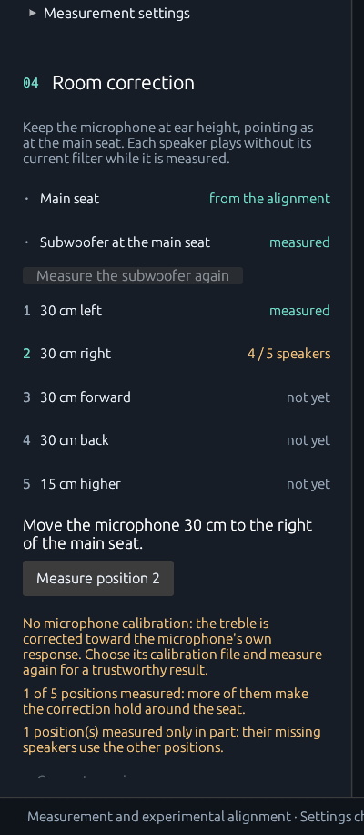
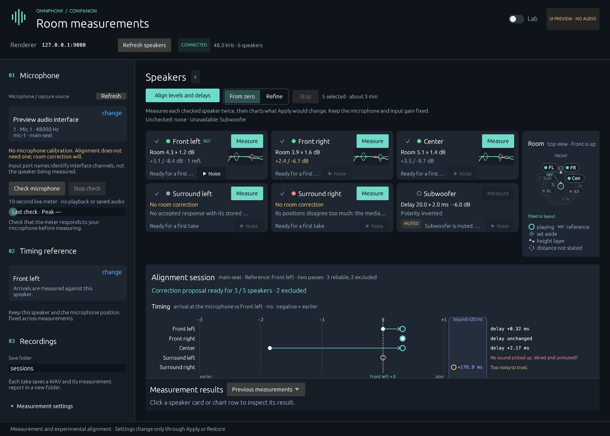
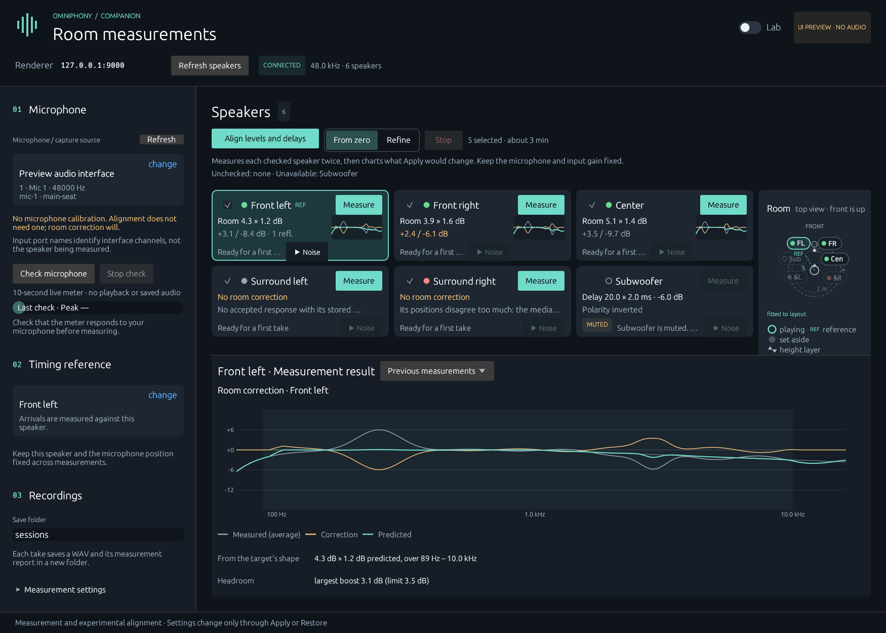
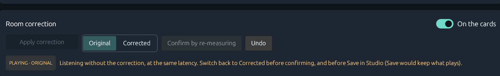
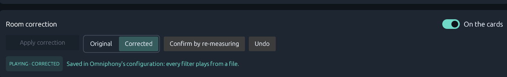

# Room correction, step by step

After the alignment, the setup rail's **04 Room correction** guides the rest: measure
around the seat, compute one correction filter per speaker together with the
subwoofer's integration, review it on the speaker cards, apply it to Omniphony, listen
to the original and the corrected sound, confirm it by measuring again, undo it if
needed. It builds on the [room-correction measurements](room-correction-measurement.md),
the [filter design](room-correction-design.md) and the
[subwoofer integration](bass-integration.md); nothing here changes how those measure or
design.

The service is `companion_service::correction`; the controller runs it on workers
(`compute_correction`, `apply_correction`, `verify_correction`), and the panels in
`companion-ui/src/correction_view.rs` only draw it.

## 1. Measure around the seat

- **Main seat**: the alignment's two passes, nothing more to do.
- **Subwoofer at the main seat** (when Omniphony has one subwoofer and speakers with a
  low limit): the subwoofer with every speaker it serves, as described in
  [subwoofer integration](bass-integration.md).
- **Positions 1–5**: 30 cm left, right, forward, back and 15 cm higher. Each
  **Measure position N** measures every aligned speaker there and, once the subwoofer
  was measured at the main seat, the subwoofer at the same position, so the microphone
  moves once per position.

The alignment may be applied meanwhile: a position is measured in the state of the
alignment's own passes (its speakers at 0 dB and 0 ms when it measured from zero, its
original settings otherwise) and Omniphony is put back as it was found. Every capture
for a correction holds the current correction filters off (protocol 8's
`bypass_output_filters`), so a new design never corrects a correction twice: the
alignment's passes and the positions record which outputs played through a filter
(`filtered_outputs`), and a design leaves such takes out with a reason. Sessions
from before this was recorded are judged by the filters their snapshot reported.

## 2. Compute

**Compute the correction** designs every speaker from the main seat and the
positions, adds nothing to Omniphony, and saves the filters as WAV files with the
design's summary and curves in a new `room-correction-<stamp>` folder of the alignment
(Studio's speaker editor loads them too, with **Choose filter…**). The subwoofer's
proposal is the one its measurements produced.

Before computing, the rail says what makes the result weaker, in plain words: no
microphone calibration (the treble then follows the microphone's own response), the
main seat only or fewer than three positions, positions measured only in part, and a
renderer older than measurement protocol 8 (the filters can then only be loaded in
Studio). Speakers whose positions disagree too much, or are too noisy, are refused by
the design with their reason. Computing again is refused while the correction plays:
undo it first, or the new correction would record the old one as the original.

Under **Lab**, **Correction settings** change the target tilt above 1 kHz, the upper
limit of the correction, the boost limit and whether the subwoofer is integrated. The
defaults need no touching; changes apply to the next computation.

## 3. Review on the cards

With **On the cards** (in the Room correction bar below the cards, on by default), each
speaker card shows its correction instead of its alignment, at the same size and place:
the distance from the target's shape before and predicted after (`Room 4.3 » 1.2 dB`),
the largest boost (the headroom the filter needs) and the deepest cut, the number of
strong early reflections, and a small plot of the measured response, the correction
and the prediction. A refused speaker says why; the subwoofer's card shows its delay,
level change, polarity and mode correction.

Clicking a card opens the detail in the drawer below: the curves (measured average,
target, correction, prediction, and the new measurement once confirmed) over the
correction band and the speaker's −6 dB point, the headroom and cut against their
limits, the band, how each position compares with the average (marked low consistency
above 2 dB), the main-seat repeatability, the strong early reflections with their delay,
level and extra path, the warnings and the speaker's sum with the subwoofer. The
subwoofer's drawer lists every speaker's sum around its crossover.

## 4. Apply, compare, undo

**Apply correction** first records what every corrected speaker plays now, so Undo can
put it back:

- no filter;
- a file the layout names: the Companion runs where Omniphony runs (the measurement
  connection is local), reads the file Omniphony reports and checks its taps against
  the hash Omniphony reports. A file that cannot be read, or that changed since
  Omniphony read it, refuses Apply with that reason;
- a live filter not saved yet: only when its taps are one of the Companion's own
  designs of this alignment (a previous correction, the subwoofer's filter). Another
  client's unsaved filter refuses Apply: press Save in Studio first, so it becomes a
  file, or remove it.

A copy of each recorded filter is kept in the correction's `previous/` folder. Then
every filter is uploaded and set with **one** `set_output_filters`, compared and swapped
on Omniphony's revision like `set_outputs`, so the speakers change together or not at
all. With the subwoofer integrated, its filter (mode correction and polarity) goes in
the same write, and its delay and level (and any delay for the other outputs) follow
with `set_outputs` once the filters are loaded. Apply waits for every filter to load and
reads the renderer back; the correction counts as applied only when every output plays
the hash that was sent.

**Original / Corrected** switches the speakers' filters for listening. Original plays
each speaker's recorded filter, or a one-tap identity where it had none: the correction
stage stays in the path, so the latency does not change and lip sync holds. The
subwoofer's integration stays as applied. The bar says which one plays.

A measurement session's `bypass_output_filters` cannot do this: a session silences
programme audio. Omniphony's `output_correction` option would switch every filter at
once at constant latency, but it is reachable only through the OSC control channel
(which the Companion does not speak), it would also switch the subwoofer's polarity
filter and any file filter of an uncorrected speaker, and it is a render setting Studio's
Save would keep switched off. Swapping the filters through protocol 8 touches only this
correction's speakers and is read back by hash.

**Undo** puts the recorded filters back in one write (none, or the recorded taps, which
Omniphony then holds as a live filter with the same hash as the file) and the
subwoofer as it was measured, its delay first. The original file stays named in
Omniphony's configuration: a Reload in Studio plays it from the file again.

Apply and the comparison are refused when Omniphony's speakers no longer match the
alignment the correction was designed from (an output routed elsewhere, another
crossover, mute, gain or delay than the alignment's original or applied settings);
Undo stays possible. If the filters went through but the subwoofer's delay write did
not, Undo still takes the subwoofer's filter back.

Every write marks the correction uncertain first and records what it asked for. A refusal (another client wrote in
between, or an old renderer) or a lost reply is settled by reading the renderer back:
the hashes show whether it is corrected, comparing, original or none of these, and
when every speaker had a filter before (the original and the comparison then play the
same), the recorded request decides. While it
is unknown, nothing else is sent, and the next connection settles it the same way.
Applying twice changes nothing.

## 5. Confirm

**Confirm by re-measuring**, with the microphone back at the main seat, measures every
corrected speaker again through its filter, as programme audio plays, and compares it
with the design: the distance from the target's shape as first measured, as predicted
and now, and how far the new measurement is from the prediction (RMS, its mean
removed). The card then shows the measured result and the drawer the new curve. With the
subwoofer integrated, its sums are confirmed too. Results are saved in a
`verification-<stamp>` folder of the correction.

## 6. Save in Studio

The Companion cannot write Omniphony's configuration. After Apply the bar says the
filters are live only: Omniphony drops them on a restart, a Reload or a profile switch,
and **Save in Omniphony Studio** keeps them, writing each one as a WAV file next to its
configuration. The Companion reads the snapshot: once every corrected speaker plays its
filter from a file with the same hash, the bar says the correction is saved.

Save while listening to the original would keep the original (and the identity filters)
instead, which the bar warns about.

## Renderer requirements and protocol gaps

Apply, compare, confirm and undo need measurement protocol 8; an older renderer is
named and refused before anything is written, and the filters can still be computed and
loaded in Studio by hand. What protocol 8 does not offer, and how the Companion works
around it:

- No way to read an output's filter taps back, nor to put a layout's file filter back:
  the Companion reads the file itself (same machine) and re-uploads its taps; Undo
  therefore leaves a live copy of the file filter (same hash) until Save or Reload.
- An unsaved filter uploaded by another client cannot be restored at all, so Apply
  refuses until it is saved.
- No session-free, per-output bypass for listening: the comparison swaps filters
  (identity taps where none was).

## Validation

- Service (`crates/companion-service/tests/correction.rs`), on a simulated renderer that
  keeps filters as protocol 8 does and plays every take through them unless bypassed:
  compute, Apply in one write, the comparison with identity filters, back to Corrected,
  Confirm (the corrected speaker measured again within 0.5 dB of the prediction and at
  less than half its first distance from the target), Undo, reload; a file filter
  recorded, compared and put back, a Save read as saved; an unsaved filter from another
  client and a changed file refused before anything is written; a write overtaken by
  another client (revision conflict) changes nothing and is not left uncertain; a lost
  reply settled by reading back, and left uncertain (persisted, every action refused)
  when the renderer cannot be read, until a refresh; an older renderer refused before
  any write; positions and alignments measured while the correction plays hold the
  filters off, and takes from before that played through a filter are left out.
  `tests/bass.rs`: the subwoofer's filter in the same write as the speakers', its delay
  and level applied, kept while comparing, and put back by Undo.
- Interface (`crates/companion-ui/tests/interface.rs`): the rail's steps and warnings,
  the cards' correction lines at the same place and size as the alignment's at
  850×640, 1160×800 and 1400×1000, the drawer's detail, the compare switch and the
  status for corrected, comparing, saved and confirmed, and an older renderer.
- Preview: `cargo run -p companion-ui --example preview -- --correction` (also
  `--correction=applied|comparing|saved|verified`, and `--select=Front left` to open the
  drawer), with synthetic data and no audio.

Nothing of this step has run against a real Omniphony, measured a real room or been
listened to.
